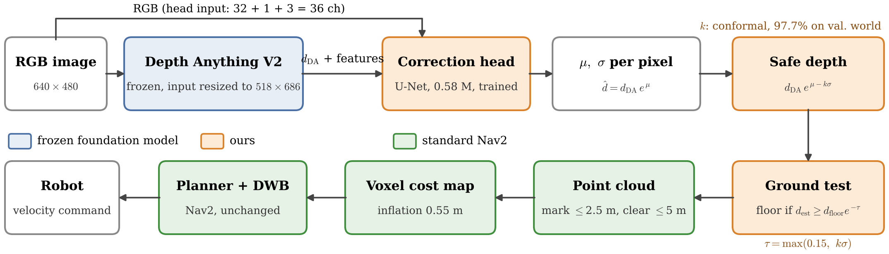

# From Depth to Safe Depth

**Uncertainty-aware monocular perception for mobile robot navigation**

Saeid Firouzi Daghigh, Saeed Ayat — Payame Noor University, Tehran, Iran

Off-the-shelf monocular depth from a foundation model (Depth Anything V2) makes a standard Nav2 stack collide in 63% of episodes, because nearby obstacles are systematically placed too far away. This repository adds a small plug-in head on the **frozen** depth model that predicts a per-pixel log-depth correction `μ` and uncertainty `σ`. Nav2 receives the conformally calibrated lower bound

```
d_safe = d_DA · exp(μ − k·σ)
```

which raises navigation success from 37% to 70% and cuts collisions to 3% (ground-truth depth: 2%), in procedurally generated indoor worlds with glass, blank walls and dark regions.



---

## Results (120 paired test episodes per method)

| Method | Success [95% CI] | Collision | Stuck / timeout / fail | SPL |
|---|---|---|---|---|
| GT depth (simulated depth camera) | 0.93 [0.87, 0.96] | 0.02 | 0.05 | 0.92 |
| Mono raw (Depth Anything V2 metric) | 0.37 [0.29, 0.46] | 0.63 | 0.00 | 0.36 |
| Mono + constant margin (`c = 0.73`) | 0.30 [0.23, 0.39] | 0.05 | 0.65 | 0.28 |
| Mono + `μ` (corrected depth) | 0.60 [0.51, 0.68] | 0.15 | 0.25 | 0.55 |
| **Mono + `μ − kσ` (ours, `k = 3.0`)** | **0.70 [0.61, 0.77]** | **0.03** | 0.27 | **0.63** |

Depth on the test worlds: AbsRel 0.262 → 0.134, δ<1.25 62.5% → 91.9%, near-range over-estimation 59.8% → 12.0%.
`k` and `c` are both calibrated to 97.7% near-pixel coverage on a held-out validation world; nothing is tuned on the test worlds.

---

## Repository layout

```
depth_safe_robot/
├── ros2_ws/src/mono_nav/            ROS 2 (ament_python) package
│   └── mono_nav/
│       ├── mono_depth.py            Depth Anything V2 -> /mono/depth (raw)
│       ├── mono_depth_safe.py       DA2 + head: modes raw | margin | mu | safe, floor snapping,
│       │                            synchronized /mono/camera_info
│       ├── uncertainty_head.py      frozen-DA2 feature hook + 36-ch mini U-Net head (shared with training)
│       ├── compare_depth.py         live predicted-vs-GT depth statistics
│       ├── gt_sync.py               GT depth with the same frames/latency as mono (optional)
│       └── odom_to_tf.py            ground-truth odom -> TF
├── mono_nav_worlds/
│   ├── worlds/                      train_01..05, test_clean, test_01..03 (+ *_goals.yaml), small_house
│   ├── tools/generate_world.py      procedural corridor + hall generator (glass / blank / dark hard cases)
│   ├── launch/world.launch.py       Gazebo Fortress + robot + ROS bridge
│   ├── ground_depth_nav2.yaml       Nav2 config for GT depth
│   ├── mono_depth_nav2.yaml         Nav2 config for all monocular variants
│   ├── setup.sh                     downloads the AWS small-house furniture models
│   └── eval/
│       ├── eval_stack.launch.py     whole stack for one world + method
│       ├── gen_episodes.py, world_map.py, gen_all.sh, episodes/   fixed, seeded episodes
│       ├── episode_runner.py        teleport -> goal -> success / collision / timeout / stuck
│       ├── run_batch.sh             all worlds x methods (eval | collect | smoke)
│       ├── collect_data.py          RGB + GT depth recorder for training
│       ├── train_head.py            β-NLL training + conformal calibration of k and c
│       └── analyze.py               tables, Wilson CIs, McNemar tests
├── checkpoints/head_best.pt         trained head (with k and c stored inside) + calib.json
├── scripts/setup.sh                 one-time setup (DA2, checkpoint, assets, build)
└── third_party/                     Depth-Anything-V2 (cloned by setup, git-ignored)
```

---

## Requirements

- Ubuntu 22.04, **ROS 2 Humble**, **Gazebo Fortress** (`ros-humble-ros-gz`)
- NVIDIA GPU with ≥ 4 GB (developed on a GTX 1650), CUDA-enabled PyTorch
- ROS packages:
  ```bash
  sudo apt install ros-humble-navigation2 ros-humble-nav2-bringup ros-humble-ros-gz \
       ros-humble-cv-bridge ros-humble-depth-image-proc ros-humble-teleop-twist-keyboard \
       python3-colcon-common-extensions
  ```
- Python: `pip install -r requirements.txt` (install PyTorch for your CUDA version first)

## Installation

The default paths assume the repository is cloned to `~/depth_safe_robot`. Elsewhere, set `WORLDS_DIR` and `ROS2_WS` (see below).

```bash
git clone https://github.com/saeed5959/depth_safe_robot.git ~/depth_safe_robot
cd ~/depth_safe_robot
./scripts/setup.sh
```

`setup.sh` clones Depth Anything V2 into `third_party/`, downloads the metric Hypersim ViT-S checkpoint, downloads the furniture models, fixes the ShoeRack model (its inertia is rejected by Fortress), fills the absolute paths in the Nav2 configs, and builds the ROS package.

In every terminal:
```bash
source /opt/ros/humble/setup.bash
source ~/depth_safe_robot/ros2_ws/install/setup.bash
export DA=~/depth_safe_robot/third_party/Depth-Anything-V2
```

---

## Quick start

Run one world with one method and RViz:
```bash
cd ~/depth_safe_robot/mono_nav_worlds/eval
ros2 launch ./eval_stack.launch.py world:=test_02 method:=mono_safe rviz:=true
```
`method` is one of `gt`, `mono`, `mono_margin`, `mono_mu`, `mono_safe`, or a sweep variant such as `mono_safe_k1.0` / `mono_margin_c0.2`. In RViz set **Fixed Frame = `odom`** and send a goal with **Nav2 Goal**. Add `debug:=true` to also publish `/mono/sigma`, `/mono/depth_raw` and `/mono/depth_corrected`.

Run a single evaluation episode against the running stack:
```bash
python3 episode_runner.py --episodes episodes/test_02.yaml --method mono_safe \
    --out results_debug --only canon_hall_far_r0
```

---

## Reproducing the paper

**1. Worlds and episodes** (already included; regenerate only if you change the generator)
```bash
cd ~/depth_safe_robot/mono_nav_worlds/tools && ./build_all.sh
cd ../eval && ./gen_all.sh
```

**2. Training data** (RGB + GT depth on the training worlds, driven by GT and raw mono)
```bash
./run_batch.sh collect           # -> eval/dataset/<world>/<method>/{rgb,depth,index.jsonl}
```

**3. Train the head and calibrate `k` and `c`** (validation world `train_03`)
```bash
python3 train_head.py --data dataset --da_repo $DA --out runs/head_v1 --epochs 5
```
The best head (by validation NLL) is saved with `k` and `c` inside `runs/head_v1/head_best.pt`; `calib.json` holds the calibration and sparsification curve. To use the published head instead, pass `head_ckpt:=~/depth_safe_robot/checkpoints/head_best.pt` to the launch file.

**4. Navigation evaluation** (120 episodes per method)
```bash
METHODS="gt mono mono_margin mono_mu mono_safe" ./run_batch.sh eval
python3 analyze.py results/results.csv --ref gt
```
`run_batch.sh` resumes: episodes already in `results/results.csv` are skipped. Delete a method's rows to rerun it.

---

## Implementation notes

These details matter for reproducing the numbers:

- **Floor snapping.** Shrinking depth along camera rays lifts floor points into phantom obstacles. Every monocular variant replaces floor pixels by the exact ray/floor intersection; a pixel is floor if `log d_est − log d_floor ≥ −τ`, with `τ = max(0.15, kσ)` for the safe variant (`floor_snap`, `floor_tau`, `floor_z` parameters of `mono_depth_safe`).
- **Synchronized camera info.** Depth Anything output arrives ~1 s after its image. `depth_image_proc` pairs depth and camera info by exact time stamp with a short queue, so the node republishes the camera info as `/mono/camera_info` with the depth stamp. Without this the point cloud is silently empty and the robot drives blind.
- **Range.** Monocular variants mark obstacles within 2.5 m and clear up to 5 m (`mono_depth_nav2.yaml`); GT marks within 4 m.
- **Input size.** The head is trained at DA2 input 518 (`518×686` for 640×480 images); the launch file uses the same.
- **Ground-truth odometry** isolates perception from localisation.

## Troubleshooting

| Symptom | Cause / fix |
|---|---|
| `No module named 'depth_anything_v2'` | `$DA` not set in that terminal |
| `package 'mono_nav' not found` | source `ros2_ws/install/setup.bash` |
| Gazebo: `invalid inertia`, world does not load | run `scripts/setup.sh` (ShoeRack fix) |
| Runner waits for Nav2 forever | the stack crashed: check `results/logs/<world>_<method>_stack.log` |
| Costmap fully magenta (lethal) in front of the robot | floor snapping off, or wrong `floor_z` (real floor in the `odom` frame, default −0.05 m) |
| Robot never sees obstacles in batch runs | point cloud empty: check `ros2 topic hz /mono/points` |
| Repos elsewhere than `~/depth_safe_robot` | `WORLDS_DIR=... ROS2_WS=... ./run_batch.sh ...` and `worlds_dir:=...` for the launch file |

---

## Citation

```bibtex
@inproceedings{firouzi2026safedepth,
  title     = {From Depth to Safe Depth: Uncertainty-Aware Monocular Perception for Mobile Robot Navigation},
  author    = {Firouzi Daghigh, Saeid and Ayat, Saeed},
  booktitle = {4th National Conference on Soft Computing and Cognitive Science},
  year      = {2026}
}
```

## Acknowledgements

[Depth Anything V2](https://github.com/DepthAnything/Depth-Anything-V2), the [AWS RoboMaker small house world](https://github.com/aws-robotics/aws-robomaker-small-house-world) (MIT-0), and [Nav2](https://github.com/ros-navigation/navigation2).

## License

MIT for the code in this repository (see `LICENSE`). Third-party models and assets keep their own licenses.

---

## Publishing (maintainer notes)

```bash
cd ~/depth_safe_robot
git status                         # review: no dataset, logs, .pth, build folders
git commit -m "Initial release: safe-depth module, worlds, evaluation and trained head"
git branch -M main
git remote add origin https://github.com/saeed5959/depth_safe_robot.git
git push -u origin main
```
After `scripts/setup.sh` the Nav2 configs contain your absolute path; keep the placeholder in git with
`git update-index --assume-unchanged mono_nav_worlds/*_nav2.yaml`.
